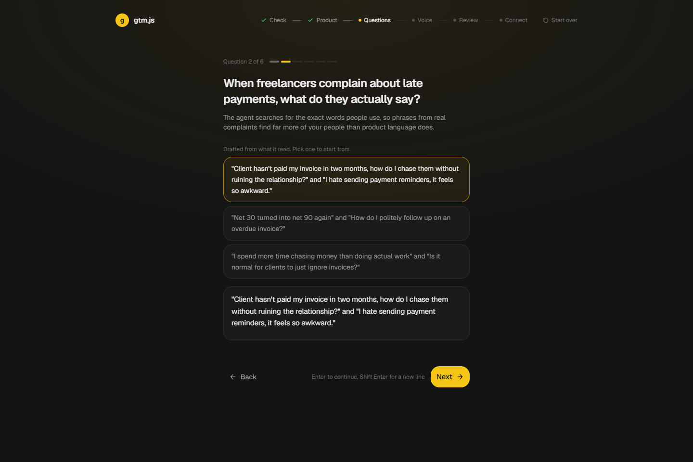
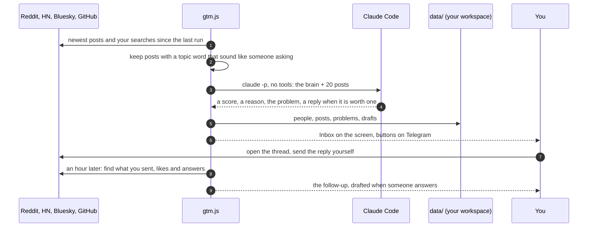
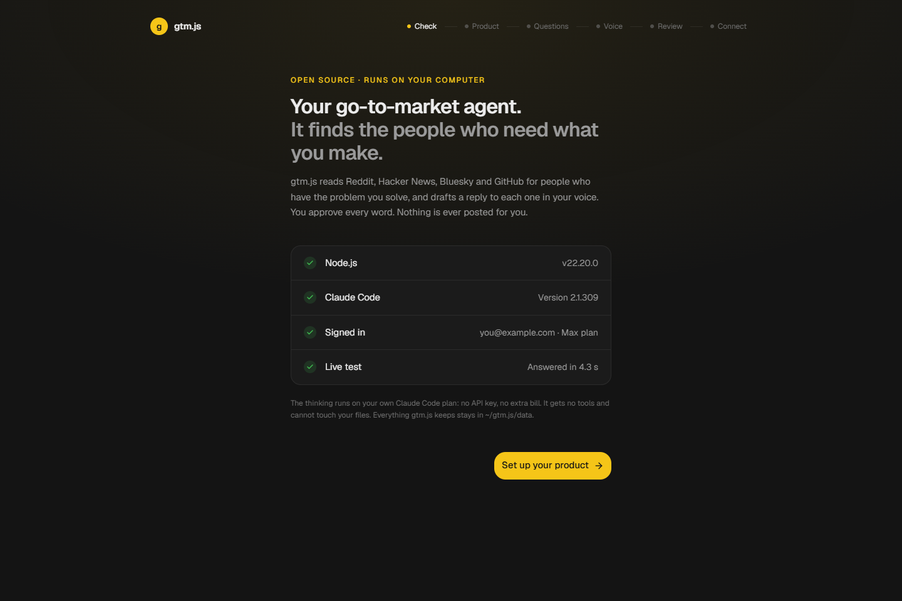
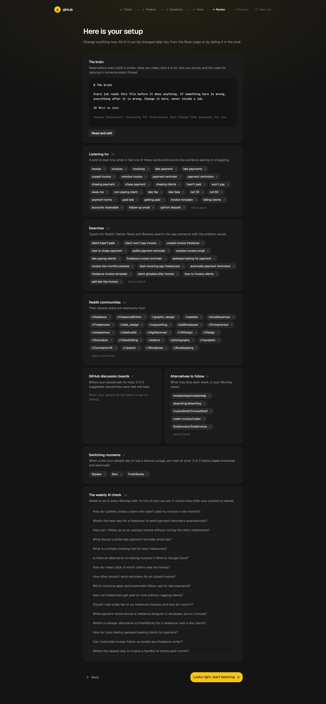
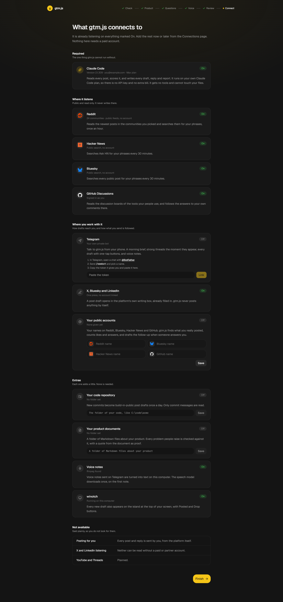

<div align="center">

# gtm.js

**A go-to-market agent that runs on your computer, on your own Claude Code.**

It reads Reddit, Hacker News, Bluesky and GitHub for people who have the problem your product solves, and drafts a reply to each one worth answering, in your voice. You approve every word; nothing is ever posted for you.

[](LICENSE)


[Quick start](#quick-start) · [Running](docs/running.md) · [Architecture](docs/architecture.md) · [Security](SECURITY.md) · [Contributing](CONTRIBUTING.md)

</div>

---



gtm.js is the part of go-to-market a founder can do every day without a team: find the people who are asking for what you make, be useful to them in their own thread, remember who they are, and learn what keeps coming up. It runs on your computer, thinks with the Claude Code you already have, and keeps everything in one folder.

- **Set up for your product in five minutes.** It reads your website and your repository, then asks six questions written for your product, each with drafted answers to pick from. It writes the brain every draft follows and picks where to listen, and checks every repository and status page before it keeps it.
- **Listens where your people talk.** The subreddits, Hacker News, Bluesky and the GitHub discussion boards of the tools they use, every 30 minutes, with a cheap filter before anything reaches the model.
- **Drafts in your voice, by your rules.** Every post is scored from 0 to 10; the ones worth answering get a reply that helps on its own and mentions your product only when someone asks. "I" or "we", no hype words, no emoji, no hashtags, no dashes: you choose.
- **Remembers people.** One person across platforms, with everything they said, the next step for each, and the follow-up drafted when they answer you.
- **Learns what hurts.** A problem board grouped into themes, the tools people blame, the questions they ask, what the alternatives shipped, and whether AI assistants name you.
- **Uses what you have.** If [Claude Code](https://docs.claude.com/en/docs/claude-code) is installed and signed in, gtm.js finds it and uses it on your own login, with no key and no extra bill. Talk to it from the screen or from Telegram.
- **Never posts for you.** A draft opens the platform's own writing box, already filled in. You press send.

## How it works

Every 30 minutes it listens, sorts cheaply, thinks only about what survived, and hands you drafts:



It is one Node process: a clock with its jobs, a small server for the screen on `127.0.0.1:4810`, and a Telegram line, all reading and writing one workspace folder. Every model call is `claude -p` with no tools, no MCP servers and none of your settings, because what it reads was written by strangers. The [architecture guide](docs/architecture.md) covers the workspace, the clock and every job, listening, thinking, the screen, Telegram and the setup. [docs/architecture.html](docs/architecture.html) is an interactive map of the whole system (download it and open it in a browser).

| Claude Code, found and tested | Your setup, ready to change | What it connects to |
| --- | --- | --- |
|  |  |  |

## Quick start

Requirements: Node.js 22.13 or newer, and [Claude Code](https://claude.com/claude-code) installed and signed in.

```sh
git clone https://github.com/ArynBuilds/gtm.js.git && cd gtm.js
npm install
npm run build
npm start
```

Open `http://localhost:4810` and follow the setup. Listening starts the moment you confirm the review.

The [running guide](docs/running.md) covers Claude Code, keeping it running at sign-in, more than one product, Telegram, settings, the public site, where your data lives, backups and troubleshooting.

## What it connects to

| | What it does | What it needs |
| --- | --- | --- |
| **Claude Code** (required) | Reads, scores, and writes every draft and report | Installed and signed in |
| Reddit, Hacker News, Bluesky | Listen for your people | Nothing |
| GitHub Discussions | Boards of the tools your people use, and answers to your comments | `gh auth login` |
| Telegram | Morning brief, strong threads at once, drafts with buttons, voice notes | A bot from @BotFather |
| X, Bluesky, LinkedIn | A post draft opens in the platform's own box, filled in | Nothing |
| Your public accounts | Finds what you really sent, counts likes and answers | Your names |
| Your code repository | New commits become build-in-public posts | A folder |
| Your product documents | Each problem people raise is checked against your docs, with a quote as proof | A folder of Markdown |

Not available: posting for you, listening on X or LinkedIn (they cannot be read without a paid or partner account), YouTube and Threads (planned).

## Security

- The screen's server listens on `127.0.0.1` only and refuses any request whose host is not `localhost`, so another site in your browser cannot reach it.
- Claude Code runs with no tools, no MCP servers, none of your `~/.claude` settings and an empty working folder. Text in a post cannot make it act.
- Everything gtm.js keeps, including the Telegram token, stays in `data/`, which is never committed. Your GitHub and Claude Code sign-ins stay with their own tools.

Read [SECURITY.md](SECURITY.md) for the full model and its limits, and report vulnerabilities privately as described there.

## Status

gtm.js is young open-source software, extracted from the agent its author runs every day for their own product.

- It is used daily on Windows; macOS and Linux run the same code but are less tried.
- There is no test suite yet; `npm run check` loads every module and typechecks the screen, and changes are tried in the running app.
- Reddit without a key allows about one request a minute, so a long gap takes a few minutes to read back.
- The screen and the drafts are in English.

## Development

```sh
GTM_DATA=./trial npm start     # a throwaway workspace that opens on the setup
npm --prefix ui run dev        # the screen with hot reload, against the running service
npm run check                  # load every module and typecheck the screen
npm run listen                 # run one job by itself: listen, think, content, learn, weekly
```

[CONTRIBUTING.md](CONTRIBUTING.md) covers the setup, the conventions and the pull-request checklist. Please follow the [Code of Conduct](CODE_OF_CONDUCT.md).

## License

[MIT](LICENSE) © 2026 gtm.js contributors.
